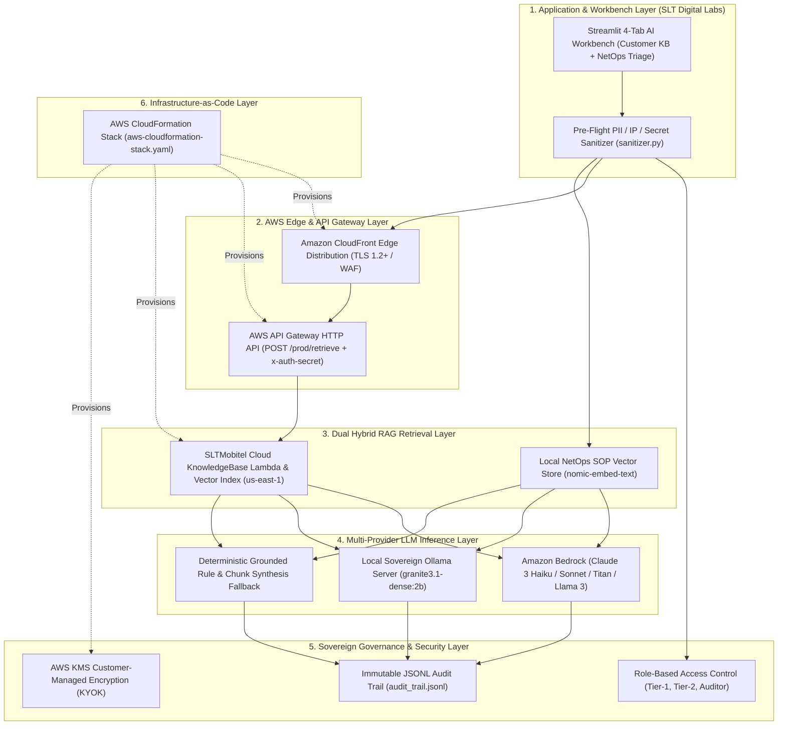

# Phase 2: High-Level Architecture Design (AWS Hybrid Sovereign Stack)
**Project:** SLTMobitel Hybrid Cloud & Sovereign AI Platform  
**Prepared by:** Mesith Rathnayake (Intern AI Engineer, SLT Digital Labs)  
**Architecture Stack:** AWS CloudFormation + Amazon CloudFront + AWS API Gateway (`/prod/retrieve`) + Amazon Bedrock + Local Ollama

---

## 1. Architectural Overview
Following the transition away from the costly IBM Sovereign Core key, the platform uses a **6-layer Hybrid Cloud & Sovereign AI Architecture**. It combines **AWS Serverless & Edge Services** (provisioned via **AWS CloudFormation** and protected by **Amazon CloudFront**) with **On-Premises Sovereign Controls** (pre-flight PII/IP sanitization, local Ollama LLM/embedding execution, and RBAC audit logging).

### High-Level Architecture Diagram


---

## 2. SLTMobitel AWS KnowledgeBase HTTP API Specification
The cloud retrieval pipeline integrates directly with the production SLTMobitel KnowledgeBase API in `us-east-1`:
* **Endpoint:** `POST https://ww5659pvgk.execute-api.us-east-1.amazonaws.com/prod/retrieve`
* **Authentication Header:** `x-auth-secret: <SLT_KB_AUTH_SECRET>`
* **Request Payload:**
  ```json
  {
    "query": "How do I check data balance?",
    "top_k": 3
  }
  ```
* **Response Payload (200 OK):**
  ```json
  {
    "query": "How do I check data balance?",
    "chunks": [
      {
        "content": "Relevant knowledge base text...",
        "score": 0.89
      }
    ],
    "count": 1
  }
  ```
